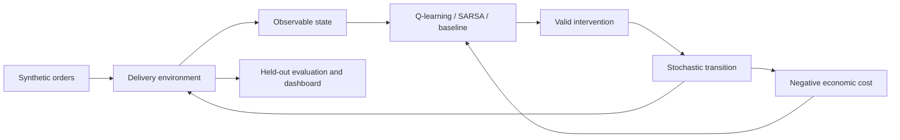

# Cost-Aware Delivery Delay Mitigation Using Reinforcement Learning

**ARLO · Delivery Decision Lab** is a complete local academic project: a stochastic logistics simulator, NumPy Q-learning and SARSA, reproducible held-out experiments, and a nine-section Streamlit dashboard including repeated-seed research experiments.

The research question is: **given an order’s known delay outlook, what sequence of feasible actions best balances delivery improvement against intervention expense?** The objective is to minimise expected cumulative intervention and delivery-delay cost.

All orders, service effects, disruption probabilities and monetary costs are **synthetic assumptions**. No supervised prediction model, external dataset or real-world causal claim is involved.

## Latest RL training improvement

The newest study improves the **individual Q-learning and SARSA agents** through longer training and a visit-dependent learning rate. It leaves the simulator, costs, reward, order distribution and baseline rules unchanged. On a separate fresh 5,000-order test set, mean cost across five training seeds was:

- Q-learning: **R$53.29616/order**.
- SARSA: **R$53.37316/order**.
- Rule baseline: **R$53.45220/order**.
- No intervention: **R$58.04500/order**.

Both learned policies have lower **observed mean** cost than the rule baseline in this run. Their advantages are modest: R$0.15604 and R$0.07904 per order respectively. The result does not establish universal superiority. The rule still has a slightly higher on-time fraction, which is compatible with the RL agents optimising monetary cost rather than on-time rate alone.

The protocol predefines two 200,000-episode training options: constant alpha 0.03, or `alpha_n(s,a) = 1 / n(s,a)^0.6`. Both use final epsilon 0.01. Two pilot seeds (11 and 22) select settings on 2,000 validation orders at seed 82026. Both algorithms select the visit schedule. Three further seeds (33,44,55) complete a five-seed confirmation, and all five frozen policies face 5,000 previously unused orders at seed **192026**. That is fourteen training runs and **2.8 million episodes**, with no final-test selection of settings or favoured seeds.

Per-pair visit counts determine the learning-rate schedule. Q-learning still uses the best valid next action, and SARSA still uses the actually selected next action. Default `visit_decay=0` preserves the previous constant-rate implementation and allows older models to load.

Run the new study and publish its verification/report with:

```bash
python scripts/improve_training.py --workers 2
python scripts/report_improvement.py
```

Use `results/improved_training/REPORT.md`, `final_summary.csv`, `final_runs.csv`, `same_test_before_after.csv`, `penalty_sensitivity_summary.csv` and `verification_tests.txt`. The before/after comparison evaluates the original 60k and improved 200k models on identical new test orders, avoiding comparisons of absolute costs across different test sets. Models live in `models/improved_training/`. The dashboard offers the extended study and loads the first predeclared seed for demonstrations without picking a seed by its test performance. The latest full suite passes **87 tests**.

A separately registered **mean-Q ensemble** experiment averages all five seed tables per algorithm. `python scripts/evaluate_ensembles.py --register` registers its protocol before final results, and `python scripts/evaluate_ensembles.py` evaluates it after training. Ensembles are explicitly labelled additional variants; they never replace individual-agent results or masquerade as a standard single run. Do not re-register an existing protocol. All earlier study results below remain as historical evidence and use different held-out order sets.

## Quick start

Install Python 3.11 or newer, then run these commands from this directory:

```bash
python -m venv .venv
```

Activate on Windows PowerShell:

```powershell
.\.venv\Scripts\Activate.ps1
```

If activation is restricted, use `.\.venv\Scripts\python.exe` in place of `python` without changing execution policy. With the Windows Python launcher, `py -3` can replace `python` when creating the environment.

Activate on macOS/Linux:

```bash
source .venv/bin/activate
```

Install and launch:

```bash
python -m pip install -r requirements.txt
python -m streamlit run app.py
```

On this delivered Windows workspace, the local `.venv` is already prepared. Double-click `run_dashboard.cmd`, or run:

```powershell
.\.venv\Scripts\python.exe -m streamlit run app.py
```

The dashboard loads the included saved models and their histories. It does not silently train on startup. Open the local address printed by Streamlit, normally `http://localhost:8501`.

## What is included

- A three-step, fully observable, finite-horizon `DeliveryMitigationEnv` with hard budgets, persistent services and stochastic disruptions.
- Independently implemented Q-learning and SARSA update equations, epsilon-greedy valid-action masking, reproducible learning curves, visit counts and local greedy-policy change tracking.
- No-intervention and stage/budget-aware rule baselines.
- Held-out matched-order evaluation, paired savings confidence intervals, scenario robustness and a separate balanced diagnostic distribution.
- Live automatic and manual demonstrations, per-stage trajectories, matched no-intervention comparison, Q-value explorer and model downloads.
- Command-line training, metadata-validated NPZ model loading, CSV results and standalone interactive HTML figures.
- Automated environment, algorithm, evaluation, reproducibility and Streamlit interaction tests.

## Architecture and files



```text
app.py                       Streamlit entry point
run_dashboard.cmd            Windows launcher
requirements.txt             Minimal direct dependencies
.streamlit/config.toml       Light navy/teal theme
delivery_rl/
  environment.py             Config, scenarios, orders, encoding, transitions
  agents.py                  Q-learning, SARSA, persistence
  training.py                Epsilon-greedy episode learning and histories
  evaluation.py              Baselines, paired evaluation, robustness
  charts.py                  Shared Plotly figures
  dashboard.py               Eight integrated dashboard sections
scripts/
  train.py                   Train either algorithm
  run_experiments.py         Reproduce the complete experiment
  run_studies.py             Five-seed validation, coverage and economics study
tests/                       Pytest and Streamlit AppTest tests
models/                      Trained .npz models with embedded metadata
results/                     Episode CSVs, summaries, metadata, HTML charts
```

## Environment and MDP

The MDP is `(S, A, P, R, gamma)`. Each episode is one order, with decisions at **Approved (0)**, **Preparing (1)** and **Dispatched (2)**. Every action advances the stage; **Delivered (3)** is terminal after exactly three decisions.

The interface follows the Gymnasium convention without a dependency on Gymnasium:

```python
state, info = env.reset(seed=42, order=order)
valid = env.get_valid_actions()
next_state, reward, terminated, truncated, info = env.step(valid[0])
```

`truncated` is always false. Terminal state is `None`, with no valid actions. Invalid actions raise `ValueError` before mutating the episode.

### State: an expanded representation

The conceptual reference `stage × risk_band × lateness_band × load` has 72 states and 288 Q entries. This implementation deliberately uses a **single expanded encoding**, rather than a lossy 72-state training option:

```text
(stage, signed_outlook + 3, load, distance, exact_remaining_budget, service_bits)
3 × 12 × 2 × 3 × 51 × 4 = 44,064 allocated nonterminal states
44,064 × 4 = 176,256 Q entries (~1.35 MiB float64 per Q-table)
```

Many allocated combinations are unreachable. `signed_outlook` is an integer from −3 to +8 days: negative values preserve early-delivery slack. Load is normal/high; distance is short/medium/long. Remaining budget is an exact integer R$0–50. Service bits encode priority (1) and transport (2). Exact budget avoids grouping states with different affordable actions. Exact integer outlook avoids hidden continuous residuals. Purchased service status is observable, and the success of completed priority processing is already reflected in outlook.

No decision-relevant persistent state is omitted. Initial budget and past spending are logged but need not enter the state: with additive costs and hard constraints, future decisions depend on **remaining** budget. Risk and coarse lateness bands are derived from the finer state, so adding them to the table would be redundant.

### Known risk and projected lateness

The displayed delay pressure is the explicit, deterministic relationship

```text
rho = sigmoid((L + 0.25*d + 0.35*h - 0.5) / 1.7)
```

where `L` is signed outlook, `d` is distance category 0–2, and `h` indicates high load. This is an **illustrative risk proxy**, not a calibrated terminal lateness probability. It rises consistently with outlook, distance and load. Displayed projected late days are `max(0,L)`; they are an outlook, not an exact mathematical conditional expectation of final late days. The final outcome always comes from the accumulated trajectory, never an unrelated risk coin flip.

Risk bands are low below 0.30, medium below 0.60, high otherwise. Lateness bands are on time, 1–2, 3–5 and above 5 days. The simulator can be configured through signed outlook or a requested risk; risk input maps to the nearest supported integer outlook and shows the actual coupled values. Inconsistent independent risk/lateness inputs are excluded deliberately.

### Actions, costs and service persistence

- **0, No intervention:** R$0; available at all decision stages.
- **1, Priority processing:** R$8; available at approval and preparation, if not already purchased.
- **2, Expedited transportation:** R$25; available at preparation and dispatch, if not already purchased.
- **3, Combined intervention:** R$32; approval only, buying both services together.

Every purchase must fit the remaining budget. There are no overruns or repeated identical service charges. Priority has one immediate opportunity to improve outlook when purchased; it covers the processing service even if that opportunity fails. Transportation bought before dispatch remains pending and has one improvement opportunity at dispatch, without another charge. Buying both services separately costs R$33; the approval bundle costs R$32. Having both services provides coordination reliability at dispatch, whether bought together or separately. These are explicit illustrative assumptions.

### Stochastic transition assumptions

The moderate scenario uses 65% priority success, 80% transport-only success and 90% component success when both services are purchased. Combined is a **two-component service**, not one all-or-nothing 90% event: its two independent success opportunities yield an 81% chance of both succeeding under moderate assumptions. Priority saves approximately one day; transport saves a uniformly selected 1–3 days. This staging makes the combined intervention's moderate total improvement 2–4 days when both components succeed.

Scenarios in `SCENARIOS` specify:

- **Pessimistic:** priority/transport/combined-component success 0.45/0.60/0.70; improvement multiplier 0.75; base disruption probability 0.32.
- **Moderate:** 0.65/0.80/0.90; multiplier 1.00; base disruption 0.18.
- **Optimistic:** 0.80/0.92/0.97; multiplier 1.25; base disruption 0.08.

Priority improvements use stochastic rounding of the multiplier (e.g. 1 day plus a 25% chance of another day in the optimistic scenario). Successful transport improvement is the rounded scaled 1–3-day draw, bounded to 1–4 days. Component improvements are never negative.

At each stage, disruption probability is `min(0.85, base + 0.10*high_load + 0.07*distance_category*is_dispatch)`. A disruption adds one day, or two when its severity draw exceeds 0.8. A disturbance draw above 0.92 gives one day of recovery; other draws leave outlook unchanged. No intervention does **not** force deterioration. All effects update the same trajectory:

```text
L_next = clip(L + disturbance_days - saved_days, -3, 8)
```

Stage-indexed random draws are pre-generated for disturbance, priority success, transport success, severity/transport magnitude and priority rounding. This is hidden future randomness, not hidden decision state. Severity and transport magnitude intentionally share a draw: more severe disruptions coincide with a larger potential transport saving. Actions do not shift any subsequent draw. Final late days are `max(0,L_3)`; no extra terminal resampling occurs.

### Synthetic initial orders

`generate_orders` samples distance/load, then a rounded normal outlook with mean `1 + 0.65*distance + 0.7*load`, standard deviation 2.2, clipped to [−3,7]. Budgets are sampled from R$0,8,25,32,40,50; the manual simulator accepts every integer budget 0–50. Each record includes order ID, derived initial risk, projected late days, distance, load and budget. The balanced diagnostic set instead samples outlook uniformly over −3…8. Seeds and manual inputs provide reproducible demonstration orders; the default manual example is +4 days, long distance, high load and R$40 budget.

## Reward and learning algorithms

With `D = max(0,L_3)`, total economic cost is

```text
C = sum_t intervention_cost(a_t) + 15*D + 20*I(D > 0).
```

Each transition pays reward `−intervention_cost`. The terminal transition also pays `−(15*D + 20*I(D>0))`. Thus **undiscounted episode reward = −C exactly**. There are no shaping bonuses. For example, R$25 intervention and two late days costs R$25 + R$30 + R$20 = R$75. Costs/penalties are configured through `EnvConfig`; scenarios through the explicit dataclasses.

Q-learning uses the off-policy target:

```text
Q(s,a) <- Q(s,a) + alpha * [r + gamma*max_valid_a' Q(s',a') - Q(s,a)]
```

SARSA uses the next action **actually drawn** by the current epsilon-greedy behaviour policy before the update:

```text
Q(s,a) <- Q(s,a) + alpha * [r + gamma*Q(s',a') - Q(s,a)]
```

Both use `target = r` at terminal states. Selection and Q-learning bootstrap values use valid actions only. Q-tables start at zero. Greedy ties choose the first valid action deterministically; an unvisited state's zero-value choice is explicitly labelled as unlearned in the live simulator. More positive Q-values mean higher expected future return; they are not probabilities.

Defaults: 15,000 episodes per algorithm, alpha 0.1, gamma 1.0, epsilon 1.0 to 0.05 using smooth exponential interpolation over the first 85% of training, seed 42. Gamma 1 aligns the finite-horizon return with undiscounted economic cost. Lower gamma is supported but represents a different objective. The dashboard exposes all these training settings.

## Training and experiments

```bash
python scripts/train.py --algorithm q_learning --episodes 15000 --seed 42
python scripts/train.py --algorithm sarsa --episodes 15000 --seed 42
python scripts/run_experiments.py
python -m pytest -q
```

Training writes `models/q_learning.npz` or `models/sarsa.npz` and the corresponding `results/*_training.csv`. The experiment runner trains **both** under moderate assumptions, evaluates 1,000 held-out orders at seed 2026, runs fixed-policy robustness across all three scenarios, and evaluates an independent balanced diagnostic distribution at seed 2027.

For a shorter smoke experiment, use `--episodes 200 --evaluation-orders 100`. This overwrites sample model/result artifacts; reproduce the defaults afterward for the supplied demonstration. `--seed` changes the training seed; `--eval-seed` changes the evaluation seed. Training uses independent streams for initial orders, transitions and exploration. Evaluation uses a separate seed namespace, frozen greedy policies, identical initial orders and matched stage-indexed outcomes for all policies. Evaluation does not mutate Q-tables or consume their action RNG.

The no-intervention baseline always chooses 0. The rule baseline chooses no intervention at low risk; prefers priority then no action at medium risk; and prefers combined, transport, priority, then no action at high risk, skipping infeasible choices. It never observes future randomness.

### Recorded metrics and uncertainty

Episode outputs record total, intervention and delay costs; final late days; on-time status; intervention occurrence; reward; per-action counts; transition seeds; and budget violations. Summary outputs include means, cost standard deviation, approximate 95% Monte Carlo cost intervals, savings versus no intervention, safe percentage savings, and **paired savings intervals** from each order’s cost difference. Action fractions count all three decisions per order.

An on-time delivery has zero final late days. Intervention frequency is the proportion of orders with at least one purchased service, rather than a per-decision percentage. Hard-budget violations must be zero. Confidence intervals use `1.96 * sample_std / sqrt(n)` and quantify held-out simulation sampling error conditional on the trained policy. They do not cover real-world model uncertainty or variability across training seeds. No significance claim is inferred from overlapping individual-policy intervals.

### Research upgrade: repeated seeds and fresh final testing

```bash
python scripts/run_studies.py
```

The stronger study uses **five independent training seeds: 11, 22, 33, 44 and 55**. Each algorithm is trained under three predefined configurations: 15,000 episodes at alpha 0.1, 60,000 at alpha 0.1, and 60,000 at alpha 0.03. All other learning assumptions remain the same. This is 30 independent training runs and 1,350,000 training episodes in total. It can take several minutes, depending on the computer.

Each configuration is evaluated on 1,000 matched validation orders (seed 82026). The configuration with the lowest **mean validation cost across all five seeds** is selected for each algorithm. Every seed from the selected configuration is then evaluated on **a separate fresh 1,000-order final test set, seed 92026**. The original seed-2026 sample is not used for selection or final testing in this study. No model is selected because it was the luckiest final-test seed.

Research intervals use approximate Student-t 95% intervals over training-seed means, conditional on shared evaluation orders. Per-run cost and paired-savings Monte Carlo intervals quantify a separate source of uncertainty. Baselines have zero training-seed variability because they do not train; this does not imply zero order-sampling uncertainty. These intervals are not combined into a real-world or hierarchical uncertainty claim.

The executed five-seed study selected **60,000 episodes at alpha 0.1 for both algorithms**. On the separate fresh final test, mean costs were **R$56.1882 for Q-learning**, **R$56.4740 for SARSA**, **R$59.5450 without intervention**, and **R$54.6550 for the rule baseline**. Approximate 95% training-seed mean intervals were ±R$0.2815 for Q-learning and ±R$0.3499 for SARSA, conditional on these final orders. Both learned policies saved money relative to no intervention, while the rule baseline remained best. Do not compare these absolute means directly to the original seed-2026 sample as if the order sets were identical.

Coverage diagnostics distinguish allocated states from the default generator's supported states, count feasible action visits, flag pairs with fewer than 10 updates, and measure unvisited states/actions actually encountered on held-out orders. The default moderate generator supports **2,844 states**, rather than all 44,064 allocated rows. Lossless removal of unreachable rows would save memory without creating additional training samples. Exact outlook, budget and service information is retained to avoid state aliasing.

Twelve additional fixed-policy economic stress tests use an independent seed 102026: six initial budgets (R$0,8,25,32,40,50), three intervention price multipliers (0.75×,1×,1.25×), and three late-day penalties (R$7.5,15,30). These are explicitly **not retraining experiments**. A changed penalty changes the accounting objective while frozen actions remain unchanged. Changed prices can also change budget feasibility and expose unvisited states; coverage is exported to make that shift visible.

All research outputs are separate from the original demonstration models/results:

- `results/studies/REPORT.md`: findings generated from executed results, including baseline comparisons and limitations.
- `results/studies/metadata.json`: seeds, predefined configurations, selected settings and completion status.
- `results/studies/validation_runs.csv`, `validation_summary.csv`: all configurations, seeds and coverage metrics.
- `results/studies/final_runs.csv`, `final_summary.csv`, `final_episodes_seed*.csv`: fresh-test results for every selected training seed.
- `results/studies/economics_runs.csv`, `economics_summary.csv`: frozen-policy sensitivity results.
- `results/studies/curve_*.csv`: actual nonoverlapping 250-episode block means for each training run.
- `results/studies/*.html`: standalone interactive research charts.
- `models/studies/*.npz`: all 30 trained snapshots; original `models/*.npz` are retained.

Use **Research experiments** in the dashboard to inspect results and load a selected research model into the live simulator. Pick a demonstration seed without cherry-picking final results. `PROFESSOR_DEMO_GUIDE.md` provides a seven-minute presentation and viva answers.

A small integration check is available with `python scripts/run_studies.py --quick`; it writes to `.study-smoke/` and does not overwrite the full research outputs. `--seeds` and `--evaluation-orders` configure full runs. Fewer than five seeds are useful for debugging but weaken the academic evidence.

### Original single-seed included run

The executed default experiment (15,000 episodes per algorithm; 1,000 held-out moderate orders) produced:

- **Q-learning:** mean economic cost **R$56.076**; on-time rate **33.2%**; average late days **2.056**; intervention expense **R$11.876**; savings **R$2.464/order (4.209%)** versus no intervention.
- **SARSA:** mean cost **R$56.548**; on-time **28.5%**; late days **2.159**; intervention expense **R$9.863**; savings **R$1.992/order (3.403%)**.
- **No intervention:** mean cost **R$58.540**; on-time **17.6%**; late days **2.804**.
- **Rule based:** mean cost **R$53.958**; on-time **37.6%**; late days **1.800**; intervention expense **R$14.478**; savings **R$4.582/order (7.827%)**.

**The rule-based policy outperformed both learned policies in this run.** The expanded state has sparse coverage at 15,000 episodes; finite training and optimistic zero initialisation can leave poorly estimated actions. These observations demonstrate real learning and an honest comparison, not convergence or RL superiority. Consult the generated CSVs for full precision and uncertainty. Exact reruns use the metadata in `results/experiment_metadata.json` and the tested package versions in `requirements-tested.txt`.

Robustness exposes an important reversal: under pessimistic assumptions, mean costs were R$69.241 for frozen Q-learning and R$69.124 for frozen SARSA, versus R$65.985 without intervention. Under optimistic assumptions these became R$46.796 and R$46.820, versus R$52.880 without intervention. A policy trained under moderate service effectiveness can spend too much when those services become less effective. The complete comparison, including the rule baseline and confidence intervals, is in `results/robustness.csv`.

### Exported artifacts

- `models/*.npz`: float64 Q-table, integer visit table and embedded JSON metadata (algorithm, training configuration, environment costs/scenario, state version and dimensions). Loading uses `allow_pickle=False`, validates dimensions/encoding and can require an exact environment configuration. Models are portable snapshots, not exact mid-training RNG checkpoints.
- `results/*_training.csv`: raw return, 250-episode moving mean, exploration, cost, interventions and local policy changes.
- `results/evaluation_episodes.csv`, `evaluation_summary.csv`: matched held-out results.
- `results/robustness.csv`: frozen moderate-trained policies under changed effectiveness.
- `results/diagnostic_episodes.csv`, `diagnostic_summary.csv`: independent balanced-outlook evaluation.
- `results/experiment_metadata.json`: seeds, episode counts, protocol and numerical runtime versions.
- `results/{learning,epsilon,cost,on_time,actions,robustness}.html`: interactive Plotly charts with embedded JavaScript; open directly in a browser without a chart CDN.

Dashboard training stores new models in session state and offers NPZ/CSV downloads. It does not overwrite disk models automatically. New training clears current evaluation and simulation caches. Saved sample overview results are clearly labelled separately from session evaluation. Restart the dashboard after replacing disk artifacts to reload them.

## Classroom demonstration

1. **Overview:** explain the problem, economic objective and delivery stages.
2. **RL environment:** inspect stage/service/budget action masks and the expanded state.
3. **Train the agents:** run either algorithm and inspect actual experience, epsilon and visits.
4. **Policy comparison:** evaluate frozen session models on held-out matched orders.
5. **Live order simulator:** configure an order or generate one, start, then select Next stage or Run full episode. Automatic mode uses the selected model; manual mode offers only valid interventions. Manual full run repeats the selected action while valid, otherwise uses no intervention. Starting inputs, model, scenario and mode are snapshotted; restart to apply changes. Final results compare the same starting order and disturbances against no intervention.
6. **Q-table & policy:** filter stage, distance, load, exact budget, service status, risk and lateness; blank heatmap cells are invalid actions. Inspect visit counts alongside the preferred action.
7. **Scenario analysis:** run fixed-policy robustness and inspect cost/service/intervention sensitivity.
8. **Research experiments:** inspect repeated-seed uncertainty, validation-only setting selection, fresh final testing, coverage and economic sensitivity. Load a selected research model for live demonstration.
9. **Methodology & limitations:** connect the live experience to the two TD equations and discuss synthetic assumptions.

A live order is one random realisation, not evidence of average effectiveness. The same seed reproduces the episode. Changing a policy can change service outcomes, but does not shift the baseline’s exogenous disturbance stream.

## Verification and troubleshooting

The automated suite checks stage progression/termination, invalid-action atomicity, all integer budgets, service persistence, exact cost/reward accounting, stochastic bounds, matched disturbances, Q-learning/SARSA equations and masking, terminal bootstrapping, exploration, model round trips and incompatible metadata, deterministic training/evaluation, summary arithmetic, frozen policies, baseline-only operation and all nine dashboard sections. Streamlit AppTest exercises manual and automatic simulation, training, held-out evaluation, all research views and research-model loading. Additional study tests check supported-state coverage, Student-t seed intervals, validation-only setting selection, budget sweeps, frozen-penalty trajectory invariance and the complete study export pipeline.

The original acceptance suite passed **74 tests**. The research upgrade extends it to **81 passing tests**, verified from `D:\ARLO Project`; the latest output is saved in `results/studies/verification_tests.txt`. Both original standalone 15,000-episode training commands and the original full experiment runner completed. Browser inspection verified the overview and an automatic live episode through delivery and matched baseline cost comparison. See `results/verification.md` for that original execution record, and `results/studies/REPORT.md` for the extended study findings.

- **`python` not found:** install Python 3.11+ and reopen the terminal; on Windows try `py -3`. The delivered local environment also runs through its explicit `.venv/Scripts/python.exe` path.
- **Activation blocked:** use the virtual environment’s Python directly; no shell policy change is needed.
- **Port in use:** append `--server.port 8502` to the Streamlit command.
- **Native Arrow library blocked by Windows Application Control:** dashboard tables use escaped HTML and CSV exports, avoiding reliance on native Arrow for rendering. No security setting changes are needed.
- **No model shown:** train in the dashboard or run the experiment script and restart.
- **Unvisited state / zero Q-values:** increase episodes, inspect visit counts or use a training-distribution order. This is reported honestly; the app does not substitute a heuristic and label it learned.
- **Learning curves fluctuate:** exploration and stochastic order difficulty contribute noise. Compare the moving mean and held-out cost rather than one episode or the raw training return.
- **RL loses to a baseline:** inspect coverage and assumptions. More episodes, learning-rate experiments and repeated training seeds are appropriate next experiments; changing displayed results is not.

## Limitations and future scope

The simulator uses integer days, bounded trajectories, fixed per-order distance/load, a small action menu and assumed intervention effects. It has no shared warehouse capacity, carrier networks or cross-order competition. The initial synthetic distribution is narrower than all manually configurable states. A 44,064-state table is computationally small but statistically sparse at modest episode counts. The included experiment uses one training seed per algorithm, and neither convergence nor superiority is guaranteed.

Risk is a coupled logistic pressure proxy, and projected lateness is not a calibrated forecast. Independent contradictory risk/lateness editing is intentionally unsupported. This is a modelling simplification relative to real forecast inputs, not a supervised prediction task. Combined intervention component probabilities and staged effects are explicitly defined above.

Future extensions include calibration from real logistics data, actual carrier prices, shared capacity constraints, delivery-network simulation, repeated-seed learning studies, contextual bandits for single-stage cases, and advanced RL only if the state/action space grows enough to justify it. No optional oracle, budget-overrun mode or scenario-specific retraining comparison is included; the documented sensitivity experiment always freezes the learned policies.
